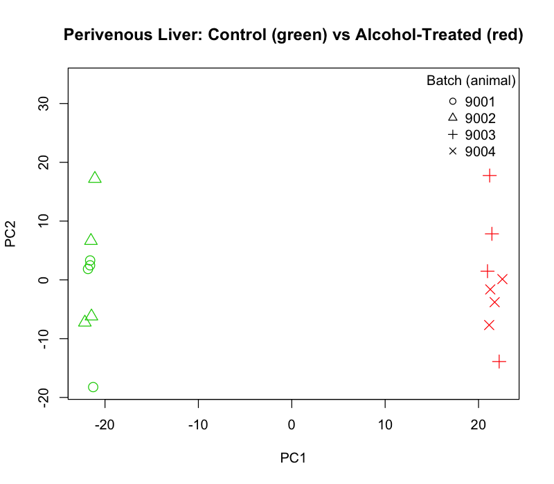
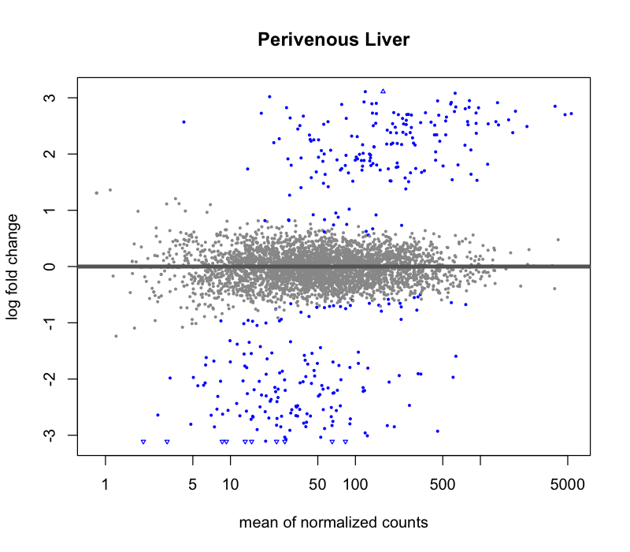
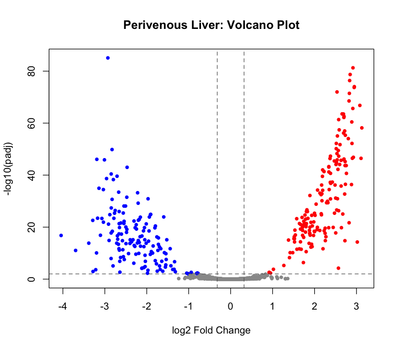
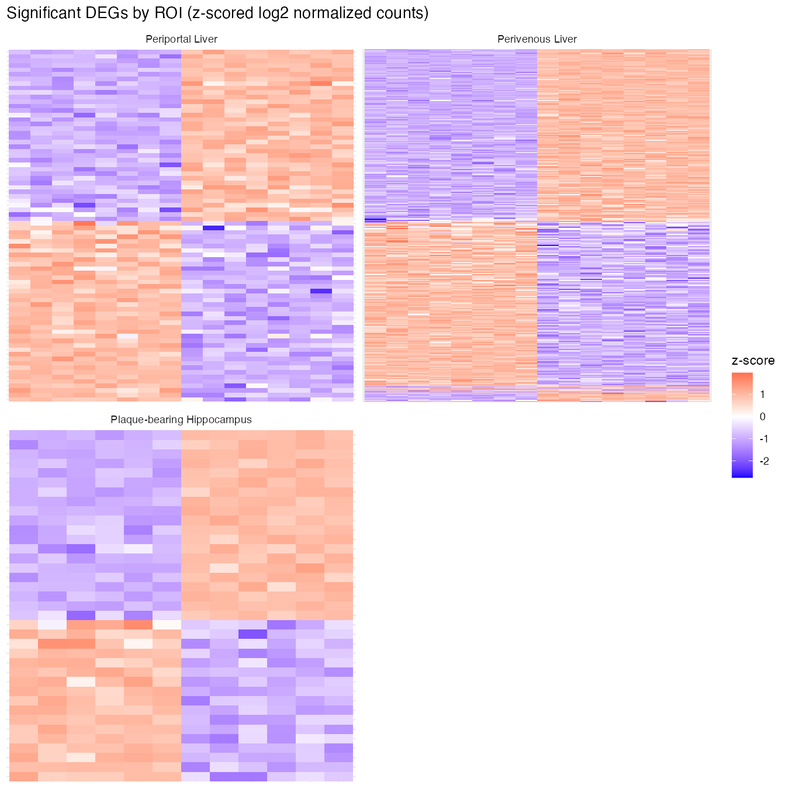

# APP/PS1-Alcohol-Liver-Brain-Spatial-Transcriptomics

This repository contains a reproducible `DESeq2` analysis pipeline designed to explore how chronic alcohol consumption influences Alzheimer's Disease (AD) pathology. By analyzing spatial transcriptomics data from the liver and brain of APP/PS1 mice intragastrically fed alcohol for 5 weeks, this pipeline identifies differentially expressed genes (DEGs) to map molecular changes associated with chronic alcohol consumption within highly specific tissue microenvironments.

> [!WARNING]
> **This is an exploratory analysis that treats ROIs as independent samples.** The study includes four mice, with two controls and two mice fed alcohol. Because several ROIs were collected from each mouse, ROIs from the same animal are not independent replicates, which is known as pseudoreplication. This means statistical significance should be interpreted with caution. A more appropriate approach can be found in [liver-brain-alcohol-geomx-animal-aware](https://github.com/ashleyduche/liver-brain-alcohol-geomx-animal-aware), which treats each animal as the replicate by adding together the ROIs from the same animal (pseudobulk).

The study data are public on GEO under [GSE324193](https://www.ncbi.nlm.nih.gov/geo/query/acc.cgi?acc=GSE324193). The pipeline runs on the provided synthetic data by default, and pointing `config.yml` at the GEO files reproduces the real analysis.

``` bash
git clone <this-repo-url>
cd liver-brain-alcohol-dge-pipeline
Rscript run_pipeline.R
```

## Methods

*This is an exploratory analysis. ROIs are treated as individual samples, so p values should be interpreted with caution.*

For the six regions of interest (ROIs), DESeq2 compares samples from mice fed alcohol with control samples within each ROI, defining the design formula as `~ Group` with controls set as reference. Statistically significant DEGs are identified using `padj <= 0.01` and`log2FoldChange > ±0.32` threshold with Benjamini Hochberg FDR correction. ROI gene lists with fewer than 10 significant DEGs are excluded from downstream analyses. Note: Batch (animal ID) is recovered from each sample's ID and used for PCA QC only. Animal ID is not included in the DESeq2 model, so ROIs from the same animal are treated as independent replicates.

## Data

`config.yml`'s `data_source` controls where data comes from:

| Mode | Setting | Purpose |
|------------------------|------------------------|------------------------|
| Example (default) | `local`, paths → `data/example/` | Synthetic 72-sample dataset, same design as the real study. Not real measurements. |
| Real data | `local`, paths → `data/raw/` | Point `config.yml` at `data/raw/` after downloading the study files from GEO. |
| GEO | `geo`, `geo.accession` set | Downloads the raw counts from GEO (GSE324193). Metadata still comes from the local file (see `R/01_fetch_from_geo.R`). |

The `data/raw/` folder is not stored in this repository. To use the real data, download the study files from GEO.

## Figures

Every run produces `results/figures/`: PCA, MA, and volcano plots per ROI, along with a faceted plot containing all output heatmaps per ROI. Examples from the synthetic data:

**PCA:** Control samples are shown in green and alcohol samples in red, with point shape showing the batch.



**MA plot:**



**Volcano plot:** Significant genes are shown in red.



**Heatmap:** Each panel shows the significant genes for one ROI as z scores.



`results/deg_tables/` contains the DESeq2 output from the example run, 
per ROI:`<ROI>_AllDEGs.csv` (complete ranked gene list) and
`<ROI>_SigDEGs_*.csv` (statistically significant DEGs).

## Structure

```         
config.yml                     ROI definitions, thresholds, data settings
R/
  00_setup.R                   loads config + shared functions
  01_fetch_from_geo.R          runs only when data_source is geo
  02_prepare_metadata.R        parses metadata
  03_pca_plots.R               PCA per ROI, before any DESeq2 object exists
  04_run_dge_all_rois.R        DESeq2 + MA/volcano plots per ROI (loop)
  04_run_dge_all_rois_no_loop.R   same steps without a loop, so change roi_name and run again
  05_compare_deg_lists.R       shared/unique DEGs across plaqueHippo, periportal, perivenous
  06_render_heatmap.R          per-ROI heatmap grid
  functions.R                  load_raw_counts(), subset_counts_by_tissue()
run_pipeline.R                 runs 00-06 in order
data/
  example/                     synthetic demo dataset (committed)
  raw/                         real data goes here (gitignored)
  processed/                   intermediate files created by the pipeline (gitignored)
results/
  normalized_counts/, comparisons/     each run's output (gitignored, regenerated)
  deg_tables/                  DESeq2 output per ROI (committed, from the example run)
  figures/                     plots from your last run, plus example_*.png (committed, used in this README)
```

Requires R with `DESeq2`, `readxl`, `dplyr`, `tidyr`, `stringr`, `ggplot2`, `yaml`. `GEOquery` is only needed for `data_source: geo`.

## Validation

Ran on the real dataset, results matched the original per-ROI scripts and statistically significant DEG lists: `nonplaqueCortex` 3 DEGs, `plaqueCortex` 0 DEGs, `nonplaqueHippo` 0 DEGs, `plaqueHippo` 97 DEGs, `periportal` 189 DEGs, `perivenous` 802 DEGs . Only `plaqueHippo`, `periportal`, and `perivenous` contained more than 10 significant DEGs and were included in downstream pathway and network analyses.

**Caution:** These counts come from a model that treats each ROI as an independent sample, even though the study includes only four animals. Because of this, they overstate the statistical evidence. These counts, along with any pathway or network results based on them, should be treated as exploratory.
